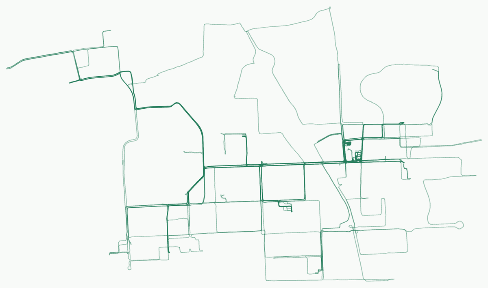

# Along

采集并归档九号骑行数据，在本地查看交互式轨迹地图与常去地点统计，导出标准化数据，并通过 GitHub Actions 定期同步。

九号官方仅提供最近 180 天的详细轨迹数据，本项目用于持久保存属于自己的完整骑行档案。

<!-- ninebot-track-image:start -->



<!-- ninebot-track-image:end -->

## 开始使用

安装 [uv](https://docs.astral.sh/uv/getting-started/installation/)（macOS / Linux），执行以下命令完成初始化与首次采集：

```bash
git clone https://github.com/Timisic/ninebot-map.git
cd ninebot-map
./scripts/setup.sh
./run start
```

按交互提示登录账号（密码隐藏输入，不落盘明文）、选择车辆并指定首次同步的起始月份。环境配置与依赖由脚本自动完成。首次采集完成后，即可运行 `./run map` 查看本地地图。

## 云端同步

本项目的主力采集机制依托于 GitHub Actions，**骑行采集只由独立私有同步仓库的 GitHub Actions 执行，本机不定时采集，无本地后台定时任务**。

- **定期同步**：默认每 10 天同步一次，GitHub Actions 每天北京时间 10:17 左右自动检查到期状态。
- **隐私隔离**：账号会话与完整历史档案加密保存在独立私有仓库的 `state` 分支；公开仓库仅更新轨迹图片（`assets/ninebot-tracks.png`），不保存任何骑行档案。

完成首次本地采集并登录 [GitHub CLI](https://cli.github.com/) 后，运行以下命令配置云端：

```bash
# 配置私有同步仓库与公开展示目标（支持指定 1~2 个公开仓库）
./run cloud install --publish-repo owner/ninebot-map --publish-repo owner/owner

./run cloud status                    # 查看云端工作流状态与下次到期时间
./run cloud map                       # 下载最新档案并在本地打开地图
./run cloud pull                      # 仅下载最新档案并更新本地标准数据
./run cloud run                       # 手动立即触发一次云端同步
./run cloud install --interval-days 7 # 修改同步周期（天）
./run cloud disable                   # 停用云端调度
```

日常使用只需在本机运行 `./run cloud map` 或 `./run cloud pull` 获取最新数据，已打开的地图会自动刷新。若会话失效需要重新登录，在本地运行 `./run login`、`./run cloud credentials` 和 `./run cloud run` 即可更新云端凭据。

## 本地轨迹地图

```bash
./run map                             # 打开已选车辆或唯一档案的本地地图
./run map --dataset /path/to/dataset.json  # 显式指定数据集文件
./run map --port 8766 --no-open       # 自定义端口或仅启动服务（不自动打开浏览器）
```

- **交互体验**：默认启动本地服务并打开 `http://127.0.0.1:8765/`，保持终端运行，按 `Ctrl-C` 退出服务。网页端不提供手动文件上传。
- **坐标与图层**：统一使用原始坐标，不进行偏移或纠偏转换。“图层”提供“道路底图”（OpenStreetMap 预览）与“经过次数”（约 200 米网格频次）两个开关，默认纯色背景无底图。
- **地点与停留**：自动对终点聚类统计常去地点，支持自定义地点命名与合并；名称含“🏸”时按去重骑行日统计羽毛球活动；自动识别奥森周边停车停留并估算自然放风时长。
- **活动切换**：页面顶部以 Riding ｜ Running 区分活动类别（Running 暂未接入数据）。

## 离线处理与静态导出

除云端同步外，亦可在本地离线执行数据增量抓取、标准数据生成与静态网站导出：

```bash
./run sync                            # 本地增量同步本月并汇总
./run sync --from 202601 --to 202603  # 本地同步指定月份范围
./run prepare --all-map-tracks        # 生成包含全部已保存轨迹的标准数据
./run prepare --map-from 2026-01-01   # 仅纳入指定日期之后的地图轨迹
./run export-site --dataset data/dataset.json --output /path/to/site # 导出静态只读网站
```

导出的静态网站仅包含脱敏后的展示字段，可直接部署至任意静态 Web 服务器。部署细节与访客公开更新配置见[静态部署说明](docs/static-deployment.md)。

## 存储与隐私

- **会话与凭据**：存储于 `.private/` 目录。
- **本地档案**：存储于 `data/` 目录。
- 两者均被 `.gitignore` 忽略，绝不会提交至 Git 或公开仓库。
- **本地定时任务**：本机不配置后台常驻守护进程（CLI 保留的 `./run schedule` 为历史 launchd 定时任务，非本项目采集器，无需安装）。详见[本地存储说明](docs/operations.md#本地存储与地图入口)。

## 相关文档

- [项目文档汇总](docs/README.md)：完整文档索引与验收验证指南
- [地图使用说明](docs/map-viewer.md)：地图交互、图层切换、统计口径与更新机制
- [运行运维说明](docs/operations.md)：云端同步架构、本地存储与发布细节
- [静态部署说明](docs/static-deployment.md)：静态站点托管与访客公开更新配置
- [开源许可证](LICENSE)：MIT License

## 未来计划

- **地方时间线**：将奥森多入口视作同一地方，积累更多到访后按月查看频次、入口变化和停车停留推算时长；少量样本不解读为趋势。
- **活动节奏**：用已有轨迹时间戳观察清晨、白天、夜晚及月份间的变化，不猜出行目的。
- **遵循宁静技术**：静默利用已有记录，无需手动打卡；数据不足时克制留白。以上为待办计划，尚未实现。
